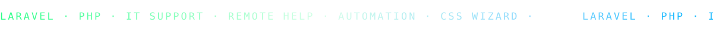
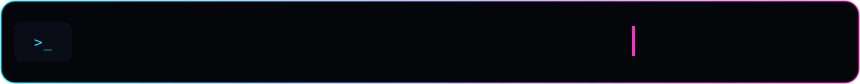
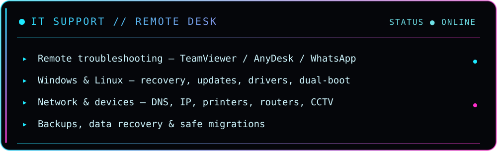
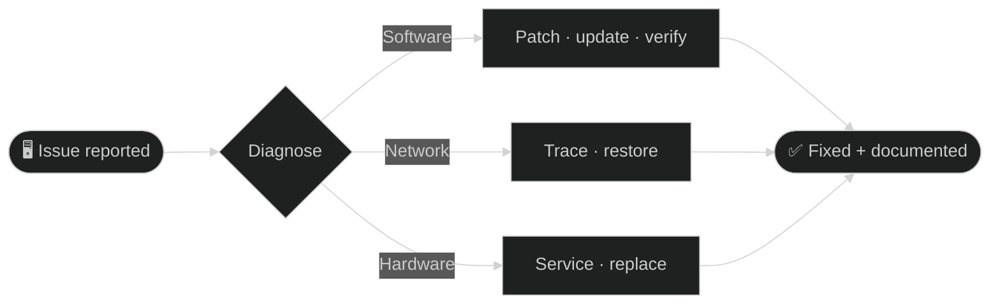

<div align="center">







<br/>

<a href="https://github.com/Ahimbisibwe-sadam"></a>
<a href="https://wa.me/256768931938?text=Hi%20Sadam%2C%20I%20found%20your%20GitHub%20profile!"></a>
<a href="mailto:sada63257@gmail.com"></a>


</div>

<br/>

<p align="center">
  <a href="#whoami">whoami</a> ·
  <a href="#what-i-do">what I do</a> ·
  <a href="#it-support">IT support</a> ·
  <a href="#arsenal">arsenal</a> ·
  <a href="#receipts">receipts</a> ·
  <a href="#snake">contribution grid</a> ·
  <a href="#work">selected work</a> ·
  <a href="#currently">currently</a> ·
  <a href="#philosophy">philosophy</a> ·
  <a href="#connect">connect</a>
</p>

<br/>

<a name="whoami"></a>
## `whoami`

```bash
$ whoami
ahimbisibwe sadam — Laravel artisan · full-stack builder · IT support technician

$ cat ./mission.txt
Build fast, clean web products from database to pixel — and keep people's
machines, networks and data running while I do it.

$ services --list
web-apps     laravel · php-native · blade · mysql · css/js
it-support   remote helpdesk · Windows & Linux · networks · backups
automation   deepseek harness · shell scripts · deploy pipelines

$ git status
On branch main — always shipping, always supporting ✦
```

<br/>

<a name="what-i-do"></a>
## 🛠️ what I do

<table width="100%">
  <tr>
    <td width="33%" valign="top">
      <h4>🧱 web apps</h4>
      <p>Full-stack Laravel products — auth, routing, Blade views, MySQL schemas and CSS that behaves. From <code>artisan serve</code> to production.</p>
      <p><code>laravel</code> <code>php</code> <code>blade</code> <code>mysql</code></p>
    </td>
    <td width="33%" valign="top">
      <h4>🩺 IT support</h4>
      <p>Remote &amp; on-desk troubleshooting: Windows/Linux recovery, drivers, printers, networks, CCTV and data. Calm hands when things are on fire.</p>
      <p><code>helpdesk</code> <code>networking</code> <code>backups</code></p>
    </td>
    <td width="33%" valign="top">
      <h4>🤖 automation</h4>
      <p>Bash scripts, deploy pipelines and AI pair-programming with DeepSeek Harness — so repetitive work never gets done twice by hand.</p>
      <p><code>bash</code> <code>git</code> <code>deepseek</code></p>
    </td>
  </tr>
</table>

<br/>

<a name="it-support"></a>
## 🩺 IT support — remote desk



<div align="center">


</div>



<div align="center">

<b>Need a hand? Remote support sessions run on WhatsApp.</b><br/>
<a href="https://wa.me/256768931938?text=Hi%20Sadam%2C%20I%20need%20IT%20support%20—%20can%20you%20help%3F">
  
</a>

</div>

<br/>

<a name="arsenal"></a>
## ⚡ arsenal

<div align="center">


<br/><br/>


</div>

<br/>

<a name="receipts"></a>
## 📊 the receipts

<div align="center">

<a href="https://github.com/Ahimbisibwe-sadam"></a>
<a href="https://github.com/Ahimbisibwe-sadam"></a>

<br/>


<br/>


</div>

<br/>

<a name="snake"></a>
## 🐍 contribution grid, but alive

<!-- Requires the neon snake workflow to run once (Actions → 🐍 Neon Snake → Run workflow).
     Until then this image 404s. See SETUP.md for the 30-second fix. -->

<div align="center">

<picture>
  <source media="(prefers-color-scheme: dark)" srcset="https://raw.githubusercontent.com/Ahimbisibwe-sadam/Ahimbisibwe-sadam/output/github-contribution-grid-snake-dark.svg" />
  <source media="(prefers-color-scheme: light)" srcset="https://raw.githubusercontent.com/Ahimbisibwe-sadam/Ahimbisibwe-sadam/output/github-contribution-grid-snake.svg" />
  
</picture>

</div>

<br/>

<a name="metrics"></a>
## 📈 self-hosted metrics

<!-- Requires the 📊 GitHub Metrics workflow to run once (Actions → 📊 GitHub Metrics → Run workflow).
     It commits a freshly generated SVG to the `metrics` branch. -->

<div align="center">


</div>

<br/>

<a name="work"></a>
## 🚀 selected work

<table width="100%">
  <tr>
    <td width="33%" valign="top">
      <h4>✦ this profile</h4>
      <p><a href="https://github.com/Ahimbisibwe-sadam/Ahimbisibwe-sadam"><b>Ahimbisibwe-sadam/Ahimbisibwe-sadam</b></a></p>
      <p>Hand-authored animated SVG banner, ticker, support card & neon design system in pure markdown.</p>
      <p><code>markdown</code> <code>svg</code> <code>css</code></p>
    </td>
    <td width="33%" valign="top">
      <h4>✦ chirper</h4>
      <p><a href="https://github.com/Ahimbisibwe-sadam/chirper"><b>Ahimbisibwe-sadam/chirper</b></a></p>
      <p>A chirp-feed web app built on Laravel + Blade — real routing, auth and hand-crafted views.</p>
      <p><code>laravel</code> <code>blade</code> <code>php</code></p>
    </td>
    <td width="33%" valign="top">
      <h4>✦ leave-web-application</h4>
      <p><a href="https://github.com/Ahimbisibwe-sadam/leave-web-application"><b>Ahimbisibwe-sadam/leave-web-application</b></a></p>
      <p>Leave-management app in native PHP — every request, query and layout hand-rolled. No framework, no crutches.</p>
      <p><code>php</code> <code>mysql</code> <code>css</code> <code>html</code></p>
    </td>
  </tr>
</table>

<p align="center">
<i>also on the workbench:</i> <a href="https://github.com/Ahimbisibwe-sadam/todo-app">todo-app</a> · <a href="https://github.com/Ahimbisibwe-sadam/CRUD">CRUD</a>
</p>

<br/>

<a name="currently"></a>
## 🧭 currently

<details>
  <summary><b>click to expand the side quests</b></summary>
  <br/>

  - 🩺 Taking on **remote IT support** — helpdesk, recovery, networks, backups
  - 🏗️ Going deeper into **Laravel**: queues, events, policies & testable architecture
  - 🧪 Writing **Pest / PHPUnit** tests that would make an artisan proud
  - 🎛️ Sprinkling **vanilla JavaScript** where a framework is overkill
  - 🤖 Pairing with **DeepSeek Harness** to ship faster without shipping slop
  - 🧠 Learning in public — one commit at a time

</details>

<br/>

<a name="philosophy"></a>
## 💡 philosophy

> *"First, solve the problem. Then, write the code."* — **John Johnson**

**Ship small. Ship clean. Ship often.**  
No dependency for a job a built-in can do — and no fix without validation.

<br/>

<a name="connect"></a>
## 📮 connect

<div align="center">

<b>Got a broken system or a wild idea? Let's talk.</b><br/><br/>

<a href="https://wa.me/256768931938?text=Hi%20Sadam%2C%20I%20found%20your%20GitHub%20profile!"></a>
<a href="mailto:sada63257@gmail.com"></a>
<a href="https://github.com/Ahimbisibwe-sadam"></a>

<!-- Add these when you're ready — just remove the comment markers.
<a href="https://x.com/YOUR_HANDLE"></a>
<a href="https://linkedin.com/in/YOUR_HANDLE"></a>
<a href="https://YOUR_SITE.dev"></a>
-->

</div>



<div align="center">

<i>Built with pure markdown, neon and PHP — © Ahimbisibwe-sadam</i>

</div>
